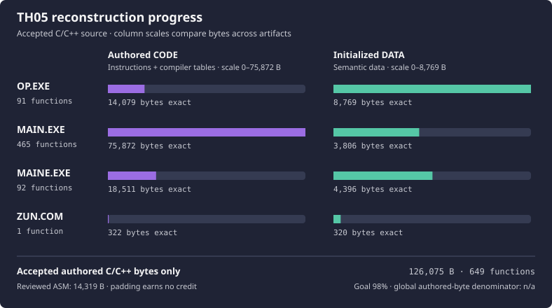

# 東方怪綺談 ～ Mystic Square

Agent workflow: follow the highest-priority requirements in [AGENTS.md](AGENTS.md). Use affected exact checks and searchable Markdown knowledge; ordinary notes do not require full CI or replay.

<p align="center">
  
</p>

Source reconstruction of the original Japanese PC-98 **Touhou 5: Mystic Square**.
The goal is **98% authored bytes exact** across `MAIN.EXE`, `OP.EXE`,
`MAINE.EXE` and `ZUN.COM`, with maintained C/C++ and justified original assembly.

The project reuses the build and analysis lessons from
[TH04](https://github.com/N0zoM1z0/th04) and
[TH03](https://github.com/N0zoM1z0/th03). ReC98 is a pinned candidate reference;
its progress and exactness labels do not transfer to this repository.

Current verified totals and artifact breakdowns are generated in
[progress](docs/PROGRESS.md) and the card above. The
[current handoff](docs/RE_HANDOFF.md) identifies pending source packets and
known blockers. Keep these sources authoritative instead of copying changing
counts into this README.

Acceptance covers complete bounded C/C++ CODE or initialized semantic DATA,
with two fresh deterministic producers, full raw bytes, original ordered fixups
and a compiled control. Reviewed original ASM has separate native ownership
decisions and counters. Padding compares normally with zero authored credit;
assets and vendor code receive no authored credit. Whole-program placement,
standalone linkage and packed-file equality are separate claims.

No global authored-byte denominator has been accepted; the overall percentage
remains **unmeasured**. The [gapless ownership inventory](resources/ownership.json)
retains every unknown interval without inferred exclusions. See the
[CL library](docs/reconstruction/CL_VENDOR_OWNERSHIP.md),
[runtime](docs/reconstruction/MAIN_RUNTIME_OWNERSHIP.md),
[Master library](docs/reconstruction/MASTER_VENDOR_ADOPTION.md),
[original ASM](docs/reconstruction/TEXT_FX_ASM_OWNERSHIP.md) and
[font resource](docs/reconstruction/ZUN_FONT_RESOURCE.md) reviews for separate
ownership evidence. ReC98 and sibling-project acceptance do not transfer.

Daily work focuses on the selected exact replay and generated-state checks.
`python3 scripts/ci.py` checks syntax across the complete public checkout,
ledger/build consistency and accidentally tracked private outputs, without
originals, private tools or pip dependencies;
`python3 scripts/ci.py --full` explicitly runs all tooling tests. Ordinary
function recovery does not require new CPU models, defensive-behavior tests
or a full test run. See the [workflow](docs/RE_WORKFLOW.md).

Replays are incremental: unchanged accepted units and tool execution probes are
reused after input identity checks. Only new or affected units are compiled.
`python3 scripts/replay_units.py --plan` shows the necessary work;
`--units ID...` selects a bounded unit explicitly. Use `--artifact op`,
`--artifact maine` or `--artifact zun` for their independent manifests and
ledgers. OP/MAINE compare cached decoded load modules, preserving observed
relocation order; packed-file equality remains a separate claim.

The standalone ZUN `-M` memory-check child also reproduces all **311 bytes**
(142 code, 169 initialized data) from maintained semantic assembly. Its
original assembly style remains inferred. This separate comparison is not an
authored-byte ownership decision or part of the C/C++ counters. See
[child source and evidence](src/zun/memory/README.md).

## Setup

Use your own Japanese game image. Game executables, assets, disk images and
proprietary compiler binaries are never included in this repository.

```sh
python3 scripts/import_targets.py /path/to/jp.hdi
python3 scripts/preflight.py
mkdir -p _reference
git clone https://github.com/nmlgc/ReC98.git _reference/ReC98
git -C _reference/ReC98 checkout --detach b6ba5b0a529edbb31efdf8c0e939263804f8ee47
bash scripts/bootstrap_toolchain.sh
bash scripts/bootstrap_analysis_toolchain.sh
bash scripts/run_heavy.sh python3 scripts/attest_toolchain.py
bash scripts/run_heavy.sh python3 scripts/ghidra.py th05-main import
```

An existing attested TH03/TH04 installation can be reused with
`bash scripts/bootstrap_toolchain.sh --from /path/to/th04` and the equivalent
analysis bootstrap option. This creates independent Wine state and reuses
immutable analysis tools. Bootstrap refuses to overlay an existing installation.
Ghidra defaults to one CPU and a 384 MiB Java heap. The heavy-job wrapper sets
a 35% CPU quota, 768 MiB memory limit, no swap, and low scheduling priority.

`python3 -m pip install -r requirements-ci.txt` installs the pinned instruction
observer used by the DIET decoder and its public negative controls.
`bash scripts/run_heavy.sh python3 scripts/unpack_targets.py` exports private
decoded payloads and ordered relocation streams. OP/MAINE execute their original
decoders at two distinct load segments; MAIN is already unpacked and ZUN is COM.

`python3 scripts/inspect_launcher.py` verifies the complete ZUN physical
partition without executing it. Ownership review and reconstruction routing
are documented in the [survey](docs/reconstruction/OWNERSHIP_SURVEY.md).

The target manifest pins the supplied copy, with `candidate-local-attested`
provenance. Independent pristine-dump confirmation remains open.

| Artifact | Bytes | SHA-256 |
| --- | ---: | --- |
| `MAIN.EXE` | 149,990 | `c41f6e6b9a97b2433acc576ceaee800707c8d4ea7e498150a259663c8fa7d4f0` |
| `OP.EXE` | 44,450 | `c94efc071a4b1adf8ce6e2c5a7eefb9eb47c26f8bab61b2e58e736dda8130abb` |
| `MAINE.EXE` | 44,321 | `8308c416e756a07766f9f66dbf5575fa12c09189059226931a9562e7272b6997` |
| `ZUN.COM` | 18,116 | `5044ae03f7c0333f37d88ef34e244502f90d7314287f6f387c07569e4e0b120e` |

## Reconstruction

- [Current handoff](docs/RE_HANDOFF.md)
- [Workflow](docs/RE_WORKFLOW.md)
- [Exact oracle contract](docs/ORACLES.md)
- [Borland reconstruction notes](docs/reconstruction/BORLAND_NOTES.md)
- [Architecture](docs/ARCHITECTURE.md)
- [Progress](docs/PROGRESS.md)

Product source lives under `src/main/`, `src/op/`, `src/maine/`, `src/zun/` and
`src/shared/`. One Borland/Wine build or Ghidra analysis runs at a time.

Repository-authored code and documentation are MIT licensed. Original game and
third-party materials retain their respective rights; see [provenance](docs/PROVENANCE.md).
