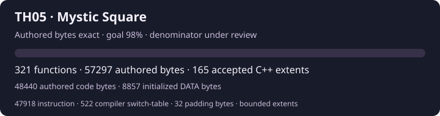

# 東方怪綺談 ～ Mystic Square

<p align="center">
  
</p>

Source reconstruction of the original Japanese PC-98 **Touhou 5: Mystic Square**.
The goal is **98% authored bytes exact** across `MAIN.EXE`, `OP.EXE`,
`MAINE.EXE` and `ZUN.COM`, with maintained C/C++ and justified original assembly.

The project reuses the build and analysis lessons from
[TH04](https://github.com/N0zoM1z0/th04) and
[TH03](https://github.com/N0zoM1z0/th03). ReC98 is a pinned candidate reference;
its progress and exactness labels do not transfer to this repository.

The first **494 complete C/C++ functions / 81,630 authored CODE bytes**
pass independent cold producers, complete raw comparison, original ordered
fixups and compiled controls. Separately, **15,269 initialized semantic DATA
bytes** pass their own compiled DATA mutations. Total authored C/C++ bytes exact are
**96,899**: 80,938 instruction, 692 compiler switch-table
and 15,269 initialized DATA bytes. Complete compared extents contain
96,978 bytes, including 79 excluded padding bytes. The oracle
supplies explicit original external-symbol bindings; whole-program placement
and standalone linkage remain open.

Separately reviewed assembly now contributes **4,483 instruction bytes,
186 symbolic CODE-dispatch table bytes and 64 semantic DATA bytes**. The
[text renderer](docs/reconstruction/TEXT_FX_ASM_OWNERSHIP.md),
[enemy VM](src/main/enemy/script.md),
[bullet generation](src/main/bullet/spawn.md),
[image kernels](docs/reconstruction/IMAGE_KERNEL_ASM_OWNERSHIP.md),
[opaque CDG](src/shared/graphics/cdg_opaque.md),
[laser geometry/render/hit](src/main/bullet/laser_render_hit.md) and
[EGC rectangles](src/shared/hardware/egc_rect_copy.md) cover
4,788 complete compared bytes with
two fresh producers and own assembled negatives. 55 checked alignment,
inert-branch and runtime-placeholder bytes compare normally with zero credit.
Explicit native ownership decisions leave C/C++ counters unchanged. Literal
historical source and original assembler identity remain unknown.

No global authored-byte denominator has been accepted yet; the overall
percentage remains **unmeasured**. See [progress](docs/PROGRESS.md) and the
[first unit evidence](docs/reconstruction/FIRST_CXX_UNITS.md). The
[gapless ownership inventory](resources/ownership.json) retains every unknown
interval across all four targets; it grants no inferred vendor exclusions.
[Reviewed Borland library evidence](docs/reconstruction/CL_VENDOR_OWNERSHIP.md)
and its artifact-specific reviews classify 47,479 third-party CODE bytes; the independent
[Master procedure review](docs/reconstruction/MASTER_VENDOR_ADOPTION.md)
and [source-backed additions](docs/reconstruction/MASTER_VENDOR_ADDITIONS.md)
classify another 2,528 CODE bytes. The [SIN8 review](docs/reconstruction/MASTER_SIN8_VENDOR_REVIEW.md)
also identifies 1,920 initialized library DATA bytes; the
[CL DATA review](docs/reconstruction/CL_DATA_OWNERSHIP.md) identifies another 1,857.
All 53,784 vendor bytes
grant no authored source credit; 2,048 CODE bytes are constants, separately
identified from instructions.

Replays are incremental: unchanged accepted units and tool execution probes are
reused after input identity checks. Only new or affected units are compiled.
`python3 scripts/replay_units.py --plan` shows the necessary work;
`--units ID...` selects a bounded unit explicitly. Add `--artifact op` or
`--artifact maine` for their independent configs and ledgers. These compare
cached decoded load modules, preserving the observed relocation order;
packed-file equality remains a separate claim.

The standalone ZUN `-M` memory-check child also reproduces all **311 bytes**
(142 code, 169 initialized data) from maintained semantic assembly. Its
original assembly style remains inferred and is reported separately from C++
instruction credit. See [child source and evidence](src/zun/memory/README.md).

## Setup

Use your own Japanese game image. Game executables, assets, disk images and
proprietary compiler binaries are never included in this repository.

```sh
python3 scripts/import_targets.py /path/to/jp.hdi
python3 scripts/preflight.py
mkdir -p _reference
git clone https://github.com/nmlgc/ReC98.git _reference/ReC98
git -C _reference/ReC98 checkout --detach b6ba5b0a529edbb31efdf8c0e939263804f8ee47
bash scripts/bootstrap_toolchain.sh
bash scripts/bootstrap_analysis_toolchain.sh
bash scripts/run_heavy.sh python3 scripts/attest_toolchain.py
bash scripts/run_heavy.sh python3 scripts/ghidra.py th05-main import
```

An existing attested TH03/TH04 installation can be reused with
`bash scripts/bootstrap_toolchain.sh --from /path/to/th04` and the equivalent
analysis bootstrap option. This creates independent Wine state and reuses
immutable analysis tools. Bootstrap refuses to overlay an existing installation.
Ghidra defaults to one CPU and a 384 MiB Java heap. The heavy-job wrapper sets
a 35% CPU quota, 768 MiB memory limit, no swap, and low scheduling priority.

`python3 -m pip install -r requirements-ci.txt` installs the pinned instruction
observer used by the DIET decoder and its public negative controls.
`bash scripts/run_heavy.sh python3 scripts/unpack_targets.py` exports private
decoded payloads and ordered relocation streams. OP/MAINE execute their original
decoders at two distinct load segments; MAIN is already unpacked and ZUN is COM.

`python3 scripts/inspect_launcher.py` verifies the complete ZUN physical
partition without executing it. Ownership review and reconstruction routing
are documented in the [survey](docs/reconstruction/OWNERSHIP_SURVEY.md).

The target manifest pins the supplied copy, with `candidate-local-attested`
provenance. Independent pristine-dump confirmation remains open.

| Artifact | Bytes | SHA-256 |
| --- | ---: | --- |
| `MAIN.EXE` | 149,990 | `c41f6e6b9a97b2433acc576ceaee800707c8d4ea7e498150a259663c8fa7d4f0` |
| `OP.EXE` | 44,450 | `c94efc071a4b1adf8ce6e2c5a7eefb9eb47c26f8bab61b2e58e736dda8130abb` |
| `MAINE.EXE` | 44,321 | `8308c416e756a07766f9f66dbf5575fa12c09189059226931a9562e7272b6997` |
| `ZUN.COM` | 18,116 | `5044ae03f7c0333f37d88ef34e244502f90d7314287f6f387c07569e4e0b120e` |

## Reconstruction

- [Current handoff](docs/RE_HANDOFF.md)
- [Local storage and evidence retention](docs/LOCAL_STORAGE.md)
- [Workflow](docs/RE_WORKFLOW.md)
- [Exact oracle contract](docs/ORACLES.md)
- [Borland reconstruction notes](docs/reconstruction/BORLAND_NOTES.md)
- [Architecture](docs/ARCHITECTURE.md)
- [Progress](docs/PROGRESS.md)

Product source lives under `src/main/`, `src/op/`, `src/maine/`, `src/zun/` and
`src/shared/`. One Borland/Wine build or Ghidra analysis runs at a time.

Repository-authored code and documentation are MIT licensed. Original game and
third-party materials retain their respective rights; see [provenance](docs/PROVENANCE.md).
